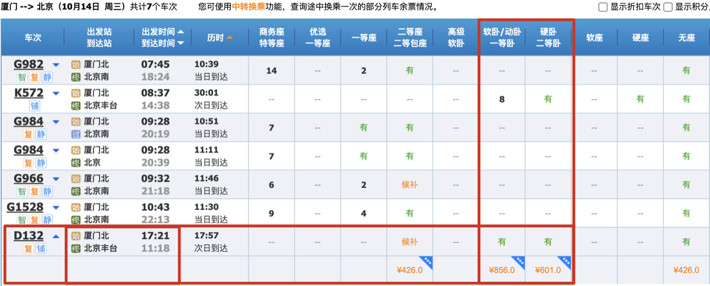
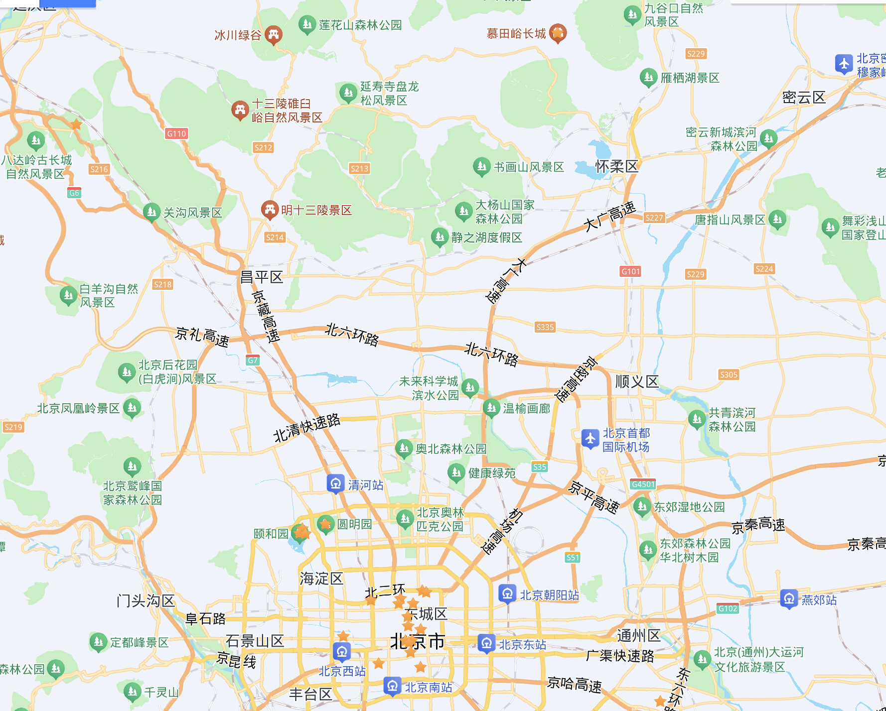
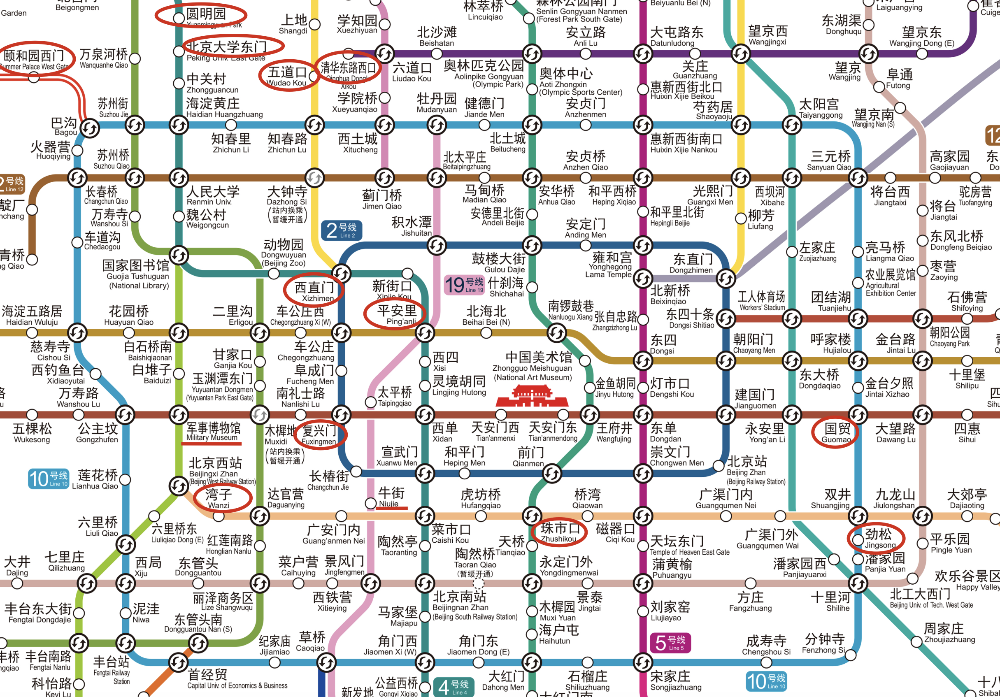

# 旅游攻略写作

> 初次实践的示例文件：Book/Family 仓库中的《北京旅游.md》。生成的文档以 `# {目的地}旅游` 为标题、开头放 `[toc]` 目录；以下各章节先给**结构骨架**（即攻略文档里的章节），再给**写作规范**。

## 触发条件

当用户说以下内容时触发：

- "写一份 xx 旅游攻略" / "做一份 xx 攻略"
- "帮我规划 xx 旅行" / "生成 xx旅游.md"
- 给出目的地 + 出行时间，要求整理成攻略文档
- 其他表达"要把一次出行整理成攻略文档"意图的文字

## 执行流程

### 1. 收集出行信息（详见「待办与概览」、「图片资源规范」）

向用户确认：出发地/目的地、出行日期区间、行程天数、同行人数、交通偏好。**生成第一个文件前必须询问保存目录**（详见「图片资源规范」）。

### 2. 计划跟进（详见「待办」）

列出关键事项待办情况

### 3. 交通方案（详见「一、旅游地来回」）

每段程给出机票（含邻近机场备选）、动车的查询链接与查询截图，用户比对后选定的方案标 ✅。

### 4. 住宿筛选（详见「二、住宿」）

按"景点位置 + 地铁口位置"两个考虑点，产出推荐地铁口小结与酒店对比表。

### 5. 每日行程（详见「三、景点行程」）

按天 D1..Dn 排景点，每景点写亮点/避坑，配门票预约表与地图示例。

### 6. 美食、导游与附录（详见「四、景点导游与附录」）

行程末尾补美食推荐与避坑提示，再加景点导游、地铁线路图等附录。

以上流程涉及的技术点，见以下对应章节。

---

## 待办

| 序号 | 类别 | 条目（锚点链接） | 状态 | 等级 |
| ---- | ---- | ---------------- | ---- | ---- |
| 1.1  | 机票✈️ | [出发-->目的地(机票)](#出发-->目的地(机票)) | 已完成✅ | 重要且紧急 |
| 2.1  | 酒店🏨 | [xx住宿酒店查找](#xx住宿酒店查找) | | 重要且紧急 |

> - 每条待办是"一件要办的事"：机票✈️ / 动车票🚅 / 酒店🏨 / 景点预约 / 景点门票🎫
> - 条目列用锚点链接（详见「五、锚点与跳转规范」）跳到对应章节，方便逐项办理
> - 状态列 `✅` 表示已办完；等级列取"重要且紧急 / 重要 / 空"

---

## 一、旅游地来回

### 0、旅游地地理位置

> 旅游路线示意图示例：
>
> 

### 1、出发地-->旅游地1

#### 飞机✈️：[出发->旅游地(机票)](机票查询链接) ✅

#### 飞机✈️（邻近机场）：[邻近机场->旅游地 或 出发地->周边机场(机票)](机票查询链接)

#### 动车🚅：[出发->旅游地(动车票)](动车查询链接)

> #### 1. 每段程都要给飞机✈️方案和动车🚅方案，且附带该方案的查询页面截图
>
> - 每段程（去程、中转、返程）各起一节，**同时给飞机✈️与动车🚅两种方案**，方便比较哪种出行方式更合适
>
> - 查询截图存入攻略同名文件夹（详见「六、图片资源规范」）
>
> - 机票查询截图示例：
>
>   
>
> - 动车查询截图示例：
>
>   
>
> #### 2. 飞机✈️方案的规则
>
> - 要**扩展邻近机场**做对比：出发地可比周边城市机场（如厦门出发，可比泉州晋江、福州长乐），目的地可比周边城市机场（如北京，可比天津）
> - **约束：机票方案不能两端都是周边机场**，必须有一端是出发地或目的地本身（"泉州晋江→北京""厦门→天津"可以，"泉州晋江→天津"不可以）
>
> #### 3. 动车🚅方案的规则
>
> - 有中转/途经段时，单独起 `##### 途经：` 小节（如 `南京->福州->尤溪`），便于了解同行人员在该途经点的下车时间信息
>
> #### 4. 每个方案要有锚点，用户选定后标 ✅ 并回填待办
>
> - 每个方案标题处加锚点（详见「五、锚点与跳转规范」），便于章节间跳转与待办表引用
> - 用户比对完方案后，在自己想要的方案后标 ✅，并在待办表中加入该方案，便于标记出行票务的执行情况

### 2、旅游地1-->旅游地2

格式同上

### 3、旅游地2-->出发地

格式同上

---

## 二、住宿

### 1、住宿优先靠近地铁口

#### 考虑点1：景点位置信息

[点击此处跳转下文的：{目的地}景点行程](#{目的地}景点行程)

> 景点位置信息示例：

#### 考虑点2：地铁口位置信息

更详细的地铁全图，请点击查看：**[附：{目的地}地铁线路图](#附：{目的地}地铁线路图)**

> 地铁口位置信息示例：

#### 小结：住宿推荐靠近的地铁口

#### 1.3.1 {站名}：{线路1}+{线路2}

### 2、[{目的地}住宿酒店查找](地图检索链接)

#### 2.1 {目的地}住宿酒店查找技巧1：一间多居室 VS 多间房

常规房：无

家庭房：如果是家庭，可以考虑住在同一间酒店，但是不同居室，某种程度上来讲，可能房间会更大显示舒适，同时价格**一间多居室的家庭房**可能比**多间常规房**经济。

#### 2.2 酒店与附近地铁口的【详细位置参考图】的查看方法

1、进入示例酒店页面：[白玉兰酒店(北京西站店)](https://hotels.ctrip.com/hotels/835618.html?cityid=1&checkIn=2026-10-31&checkOut=2026-11-01&crn=1&adult=2&children=0&detailFilters=29%7C1%7E29%7E1%7C2)

2、点击页面中的**在地图上查看**，如下图所示

3、得到下下图中的**酒店与附近地铁口的【详细位置参考图】**

酒店介绍

酒店与附近地铁口的【详细位置参考图】

#### 2.2 备选酒店对比表

##### 常规房

| 来源   | 酒店（详情页链接）   | 地铁站🚇              | 参考价 面积㎡/床m/价格￥ | 评价     | 其他 |
| ------ | -------------------- | -------------------- | --------------------------- | -------- | ---- |
| 携程网 | [酒店名](详情页链接) | 地铁站: 站名（距离） | 20㎡/1.8米/354￥            | 4.7/2479 |      |

##### 家庭房

表格格式同上

> 可以考虑家庭房的前提下才有此项。

---

## 三、景点每日行程

略

---

## 四、景点导游与附录

### 1、{景点}（导览 app/小程序 + 导览地图链接）

### 附：{目的地}地铁线路图

### 写作规范

- 导游：每个重点景点给导览 app/小程序截图 + 官方导览地图链接
- 附录：地铁线路图等大图资料，供住宿章节引用

---

## 五、锚点与跳转规范

- 目标小节上方放手动锚点：``，跳转写法 `[显示文字](#中文锚点)`

---

---

> **引用规范**：SKILL.md 中引用 AI-qskills 内的其他项目必须使用 GitHub 链接，格式：[AI-qskills 中的 xxx](https://github.com/dvlproad/AI-qskills/blob/main/xxx/SKILL.md)，禁止使用本地绝对路径。
>
> **注意**：以下过渡语仅适用于非 skill 环境（如直接复制给 DeepSeek 等使用）。在 OpenCode 等 skill 环境中，此段落不生效。
>
> **过渡语**：以后我输入"写一份 xx 旅游攻略"的格式，你就直接按模板生成攻略文档。明白请回复"明白"

---

## 版本记录

### 0.0.1 (2026-10-14): 初始版本
